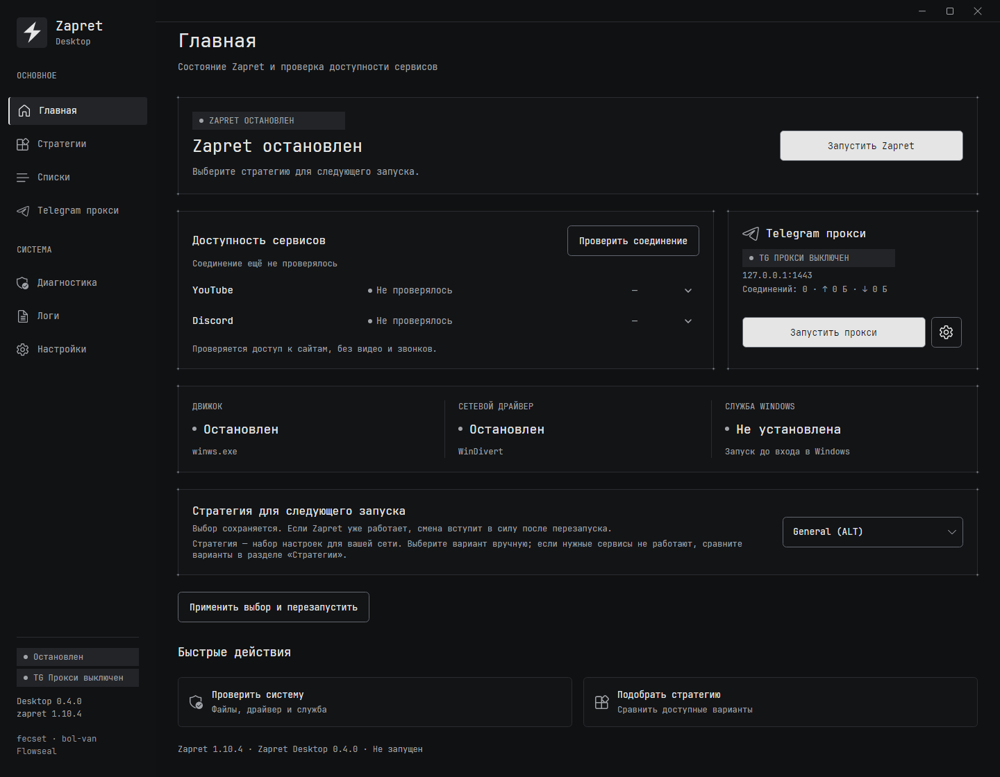

#  Zapret Desktop

**Приложение для управления Zapret на Windows:** запуск, выбор и проверка стратегий, редактирование списков, встроенный Telegram-прокси и обновления.

`Windows 10/11 x64` · `v0.4.0`

Использует движок и стратегии из [дистрибутива Flowseal](https://github.com/Flowseal/zapret-discord-youtube), основанного на [zapret от bol-van](https://github.com/bol-van/zapret).

## 🖥️ Интерфейс



## ▶️ Установка и запуск

1. Скачайте ZIP для Windows x64 из [Releases](https://github.com/fecset/zapret-desktop/releases/latest).
2. Распакуйте архив целиком в отдельную папку. Оставьте `Zapret.Desktop.exe` рядом с папкой `zapret`.
3. Запустите `Zapret.Desktop.exe` и подтвердите запрос прав администратора.
4. Выберите стратегию на главной странице и нажмите «Запустить Zapret».

Устанавливать .NET отдельно не требуется. Подходящая стратегия зависит от провайдера: если соединение не работает, попробуйте другую или запустите автоподбор.

## ✈️ Telegram прокси

Встроенный MTProto-прокси для Telegram Desktop работает внутри `Zapret.Desktop.exe`; отдельный EXE или Python не нужен.

1. Откройте раздел «Telegram прокси» и нажмите «Запустить прокси».
2. Нажмите «Открыть в Telegram» и подтвердите добавление прокси.
3. Если порт 1443 занят, измените его в настройках прокси и сохраните.

Ключ создаётся при первом запуске и хранится с защитой Windows DPAPI. Автозапуск по умолчанию выключен. При сворачивании в трей прокси продолжает работать, при полном выходе Desktop останавливается. Zapret и Telegram прокси управляются независимо.

Подробнее: [подключение, настройки и ограничения](docs/TELEGRAM_PROXY.md).

## 🗂️ Возможности

| Раздел | Возможности |
| --- | --- |
| Главная | Запуск и остановка Zapret, состояние движка, драйвера и службы, проверка YouTube и Discord |
| Стратегии | Выбор стратегии, автоподбор и история результатов |
| Списки | Просмотр и редактирование доменов и IP-адресов |
| Telegram прокси | Встроенный MTProto-прокси для Telegram Desktop: запуск, ключ, порт, маршруты и статистика |
| Диагностика | Проверка файлов, службы, драйвера, DNS, hosts и возможных конфликтов |
| Логи | Журнал действий и ошибок |
| Настройки | Фильтры, служба Windows, автозапуск, тема, резервные копии, IPSet, hosts, payload и обновления |

Перед автоподбором остановите Zapret и удалите службу Zapret в «Настройках», если она установлена. На время теста списки и диагностика недоступны.

После изменения списков или фильтров перезапустите Zapret, чтобы применить изменения.

Для полного выхода используйте меню значка в трее → «Выход». Это останавливает движок, запущенный Desktop. Установленная служба Windows работает независимо от приложения.

Чтобы Desktop и выбранная стратегия запускались при входе в Windows, включите «Запускать приложение вместе с Windows» и «Запускать Zapret при открытии приложения» в настройках. Для запуска Zapret до входа пользователя используйте службу Windows.

После включения автозапуска появляется пункт «При автозапуске сворачивать окно в трей». Он скрывает окно только при входе в Windows; ручной запуск открывает интерфейс. Нажмите «Сохранить настройки», чтобы применить выбор.

## 💾 Данные и обновление

Пользовательские списки находятся в `zapret/lists`, а настройки, история и резервные копии — в `%LOCALAPPDATA%\ZapretDesktop`.

Перед ручным обновлением откройте «Настройки → Резервные копии и перенос данных», нажмите «Экспорт ZIP» и сохраните архив вне папки приложения. Закройте Desktop через трей и остановите службу, если она используется. Распакуйте новую версию в отдельную папку и перенесите данные через «Импорт ZIP».

Обновления Desktop и движка также доступны в «Настройках → Обновления». Обновление zapret устанавливается одной кнопкой: приложение само останавливает и перезапускает Zapret. После обновления Desktop приложение запускается снова; службу перед установкой нужно остановить.

Подробности переноса и восстановления данных — в [инструкции пользователя](docs/README-release.md).

## 🔧 Если что-то не работает

Откройте «Логи» и запустите «Диагностику». Если проблема остаётся, создайте [issue](https://github.com/fecset/zapret-desktop/issues), указав версию Desktop, версию Windows, действия перед ошибкой и относящиеся к ней строки журнала.

Проверка доступности YouTube и Discord не проверяет воспроизведение видео и голосовую связь. Если сайт открывается, а видео или звонки не работают, попробуйте другую стратегию.

## 🛠️ Сборка из исходников

Понадобятся Windows x64, .NET 10 SDK и Git.

```powershell
dotnet restore ZapretDesktop.slnx
dotnet build ZapretDesktop.slnx -c Release
dotnet test ZapretDesktop.slnx -c Release
```

Запуск приложения:

```powershell
dotnet run --project src/Zapret.Desktop/Zapret.Desktop.csproj
```

Сборка ZIP: `./scripts/Build-Release.ps1`. Устройство проекта описано в [ARCHITECTURE.md](ARCHITECTURE.md).

## ⚖️ Лицензии

Код Zapret Desktop © [fecset](https://github.com/fecset), [MIT](LICENSE). Лицензия и уведомления дистрибутива zapret от bol-van и Flowseal находятся в [`zapret/LICENSE.txt`](zapret/LICENSE.txt). WinDivert распространяется по LGPLv3 или GPLv2 на выбор — [текст лицензии](licenses/WinDivert-LICENSE.txt).

Telegram прокси — адаптированная C#-реализация [TG WS Proxy](https://github.com/Flowseal/tg-ws-proxy) © Flowseal, [MIT](licenses/TG-WS-Proxy-LICENSE.txt). Лицензии остальных компонентов и условия использования логотипа Telegram перечислены в [THIRD_PARTY_NOTICES.md](THIRD_PARTY_NOTICES.md).
